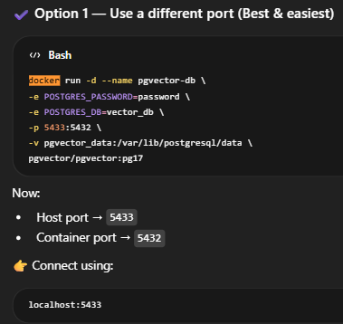

Ai service notes:
1.Incident Classification:

first understand what happened and why we need:
so while creating an incident from incident service we just need to pass the Incident Title and Description as these are compulsory fields
rest of field like serviceName,category,Priority,Severity are optional while creating an incident..as the incident creator might not now all these details at the time of creating an incident..

SO what our are Ai service is  doing: it consume the incident Created event 
on which it apply  classificationService: which  predict the serviceName,category,Priority,Severity fields based on User+System Prompt. using the Google Gemeni Ai model.
along with this it also gives the confidence score for it prediction based on  matching with the actualy fields that the incident creator filled..so that user can choose weather to choose/use the predication or not
it also gives the summary of the incident for better understanding.

2. Getting the previously resolved incident information using Rag:

suppose the same/similar incident is happen again that we resolved earlier ... if that case if the user  get the info 
like is that same event happen before?
how we previously  we resolve tha incident(rootCause)? 
then  it will be really easy for the user to resolve the incident faster by applying the same/similar solution

Storing data in vector database:
so what our Ai servcie is doing:  it consume the incident Resolved event.
and using the RagIntegration service.. method ProcessResolvedIncident ..to first apply ETL pipline and then  store the resolved incident information in vector database...
Information like Incident,Description,Category,Service,Root Cause,Resolution.

--------------------------------------------
setup that is necessary: since i try use qdrant as vector db early but it cause issue:
for both manual and auto configuration so i am using the pgvector.
but here also an issue is comming that google gemeni Embedding model that i am using has the gives dimmention of 3072 for embedding of content but HNSW index in pgvector  only support till 2048 dimmention...and also we does not have any other embedding model what gives the result below 2048 dimmention...
so i decide to manually create that table inside the pgvector docker without  index so also No HNSW
such that now  the embedding with 3072 dimmention can be stored in the vector database.

1.Disable the auto vector table schema generation in pgvector
2.Create the table manually without HNSW index
CREATE TABLE resolved_incidents_vectors (
id uuid PRIMARY KEY,
content text,
metadata jsonb,
embedding vector(3072)
);

what actually is HNSW index?
HNSW stands for Hierarchical Navigable Small World.
it is a type of index used in vector databases to enable efficient similarity search.
it make a graph-based index structure that organizes the vectors in a way that allows for fast retrieval of similar vectors based on their proximity in the vector space.
without this similarity search will be slower as it then search happens linearly O(n) but with HNSW index it can be much faster O(log n) or even O(1) in some cases.

But, it can handle  dimensionality of the vectors till 2048, that is why we had to create a table without the HNSW index to store our 3072-dimensional embeddings.

our project will still works well without this as we have not too much entries.

now how to setup the pgvector with docker for my use:
1. make a pgvector(already has posgress) from docker  
docker run -d --name pgvector-db \
-e POSTGRES_PASSWORD=password_u_wantToSet \
-e POSTGRES_DB=vector_db \
-p 5433:5432 \
-v pgvector_data:/var/lib/postgresql/data \
pgvector/pgvector:pg17

2. go inside the docker and create the table manually without HNSW index
   A. Goo inside the docker using below command:
docker exec -it pgvector-db psql -U postgres -d vector_db

   B. then create the table using below command:
   CREATE TABLE resolved_incidents_vectors (
   id UUID PRIMARY KEY,
   content TEXT,
   metadata JSONB,
   embedding VECTOR(3072)
   );

---------------for seeing is the data is stored in the vector database :
commnads:
1. to see  data stored in the vector database:
   SELECT id, content ,metadata FROM vector_store LIMIT 1;
2. to see schema of the table:
   \d vector_store

-----------------
so yes now the Ai RagIntegrationService is ready to consume the IncidentResolutionReportEvent from reporting service and then apply the ETL pipline and store the resolved incident information in vector database for future use.

and using the Get call we can get information of how the similar incident is resolved in past. like root cause and resolutionNotes etc 

--------------------
Engineers Recommendation Flow:
New Incident
↓
AI Service
↓
Embedding Generation
↓
Vector Similarity Search
↓
Historical Similar Incidents
↓
Extract Engineer Metadata
↓
Fetch Engineer Stats
↓
Fetch Engineer Workload
↓
Backend Ranking Algorithm
↓
Top Engineers Selected
↓
(Optional) LLM Explanation
↓
Return Recommendation