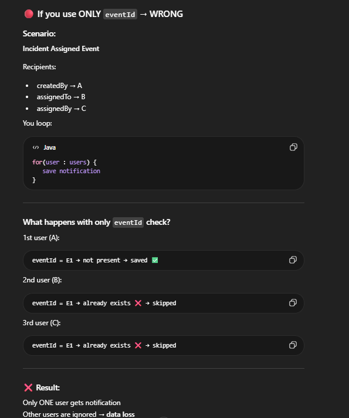

Actually in this service we made the Event Listner that will consume the events produced by Incident Service
producers.
like IncidentCreated,Incident Assigned,Incident Status Updated etc
but the listner in that service will not send email to anywhere, rightnow it will just show the console messgae that we recieve this email and then stroing it in Database of Notification Service. 
in future when we will use Mailhug from docker. then this service send the mails recieved by its Event recievers to the Mailhug and then we can see the mails in Mailhug dashboard .
Everythink happened will be locally in our system.
-----------------------

Write now we use this Notification Service for :
Consume Kafka Event
→ Process Template
→ Send Email/SMS/Push (to be done by adding real configuration)
->storing in Notification Service DB
→ Done

-----------------------------------------------
Flow For Incident Created Event:

Kafka Event Received
↓
Fetch Recipient Users
↓
FOR EACH USER:
Create NotificationLog(PENDING)
↓
Try Process Notification
↓
SUCCESS → Update SUCCESS
FAILED → Update FAILED + reason

-------------------------------------
Handing Kafka Duplicate Processing using Idempontency Key:
As when we are sending the Incident(creation/assigning/update status) events from Incident Service using the producer's that is used by notification Service Consumers.
now suppose a situation arrise that incident Created Event is consumed by our consumer ...Event consumer  did all the steps like 
1.setting the EventDto value to the entity object of Notification Service.
2.save it to db.
but just before completing the consumer block some exception arrise like:Consumer crashes,various Exception occurs,Offset not committed.
so our block fails...
now as the default behavior (10 times retry if fails) of kafka
our consumer again 1.setting the EventDto value to the entity object of Notification Service.
2.save it to db.
and as there is no any unique constraint or idempotency key in place,so it will save the same event again in the database and so dublicate entries made there so 
then it will cause various issue 
like 1. it will send the email again to the same user for the same incident created event.

So to handle this we need to use the idempotent consumer pattern.
idempotency means: performing the same operation multiple times gives the same result as performing it once.
so for this
1.we need to add the a new field in kafkaEventDto like private UUID eventId;// this will be a unique identifier for each event.
2.we need to add a new field in our NotificationLog entity like private UUID eventId; // this will be used to store the eventId from the KafkaEventDto. and used in verifying the uniqueness of the event in the database.
3.add the @UniqueConstraint(
columnNames = {"eventId", "recipientEmail"} 
in  our NotificationLog entity for handling the uniqueness and eventually this is basically call the idempotent key(eventId+email  combination).

so now when at consumer function we try to save the entry in db it check that entry is unique if yes then save.
if no then it we handle that exception greasfully using the try catch block.
this above approach will work for both single threaded and multi threaded systems.
 case of Multithread for just understanding:
 Imagine Multiple Kafka Consumers(so Multiple Threads) running at same time means  concurrent environment
So Thread 1 and Thread 2 dono nai check keya ki
eventId and recipientEmail already exist kar chuka hai database me ya nahi?
dono check kar rahe hain same time pe and abhi same (eventId and recipientEmail) vali entry  exist nahi karte hai so  dono condition pass karke proceed kar gaye and try karenge   database me save karne ki.
but any of one thread ka  operation successful save ho jayega  database me and (eventId and recipientEmail) vali entry exist kar jaaye gai, so jab dusra thread try karga save karne ki to vo operation fail ho jayega because of unique constraint violation in database.and we will see DataIntegrityViolationException.
that exception is handle in our try catch block effectively by us.

why need to send the email along with eventId in the check?

because jab multiple users are there to receive the same notification for the same event
like : when  assigned event Incident occur then we have to send the email to : assigned by user, assigned to user, Created By user.
and agar ham only eventId check karte hain without recipientEmail then first user ko email send ho jayega and uske baad agar same eventId ke liye dusra user ko email send karna hai to wo check fail ho jayega because eventId already exist kar chuka hai database me for the first user, so dusra user ko email nahi milega.
thats why we are using both eventId and recipientEmail .
so idempotency key is a combination of eventId and recipientEmail .
Idempotency key = eventId + recipientEmail
, 

----------------
Important:
Qustion comes in mind why we are making the private UUID eventId field in each Incident eventDto if we have the private UUID incidentId; there?
because incidentId ≠ eventId
Concept	Meaning:
incidentId:	Same for entire lifecycle of incident(same for Incident created, assigned, status updated etc)
eventId:	Unique for every event occurrence(different for incident created, assigned, status updated etc)

1.suppose Ki agar Hamm  incidentId + recipientEmail ko use karte hain as idempotency key:
so idempotence condition ye hote:

issue kya tha ki jese admin nai ek incident create kiya to uske incidentId and Email save ho jaye Notification db mai.

ab same admin ne us incident ko assign kar diya(as Assigner) kisi user ko to ab kya hoga ki admin ko ab mail nahi jayege  
because jab admin(toassigner) ki time condition check hoge to incidentId and email already exist kar chuka hai database me(during incident created event) .

that why hamm eventId + recipientEmail ko use karte hain as idempotency key.
-----------------
so here in mind:
Incident (Entity)
↓
Multiple Events
↓
Each Event has unique eventId
↓
Each Event creates multiple notifications
↓
Each notification = (eventId + recipientEmail)

-------------------------
To Be Done Later: But Important:

1.We are not making the new api's

as for now:Keep Notification Service Internal/Event Driven Only.
and No controller needed.

in future :
we will do advancements in the Notification Service by adding APIs for better management and monitoring of notifications. Some of the potential features include:
A. View Notification History

Example:

GET /notifications
GET /notifications/{id}

To check:

Was notification sent?
To whom?
When?
For what event?

----
B. Retry Failed Notifications

Example:

POST /notifications/{id}/retry

---
C. Admin Dashboard / Monitoring

Example:

GET /notifications/stats

Need counts:

Sent
Failed
Pending

----
D. User Preferences

Example:

PUT /notifications/preferences

User may disable:

email
SMS
push
E. Manual Triggering

Example:

POST /notifications/test-email

Useful for admins/testing.

-----------------------------------------
2.we also need to Handle this in future for better reliability and fault tolerance:

Proper logging
Try/catch
DefaultErrorHandler
FixedBackOff retry
Dead Letter Topic
Separate DLQ consumer

primarily for Kafka/event-driven processing, (NOT for every normal REST API. Because Kafka consumers behave differently than HTTP APIs.)

For Rest Api we will use:
Resilience4j Retry
Circuit Breaker
Timeout
Fallback

As right now what happen is :
Suppose your listener is:
----------
@KafkaListener(topics="incident.created")
public void consume(IncidentCreatedEvent event){
userClient.getBatchUsers(...); // fails here
}
----------
if userClient throws exception:
Then:
Listener failed
→ Offset not committed
→ Kafka retries same message (default 10 times)

this is basic retry logic.

But if we want to have more control over retries and failures, we can implement a more robust error handling strategy. This includes:
1. Proper Logging: Log the error details for debugging and monitoring purposes.
2. Try/Catch: Wrap the processing logic in a try/catch block to handle exceptions gracefully.
3. DefaultErrorHandler: Use Spring Kafka's DefaultErrorHandler to manage retries and failures.
4. FixedBackOff Retry: Configure a fixed backoff strategy for retries to avoid overwhelming the system.
5. Dead Letter Topic: Send failed messages to a dead letter topic after exhausting retries for further analysis.
6. Separate DLQ Consumer: Create a separate consumer to process messages from the dead

Finally keep in mind:
failure handling by communication type are different:
REST failure ≠ Kafka failure
DB failure ≠ Kafka failure
Cache failure ≠ External API failure

If communication is HTTP/REST:
→ Handle via exceptions/status codes/resilience patterns

If communication is Kafka/Event:
→ Handle via retry/backoff/DLQ/error handlers
