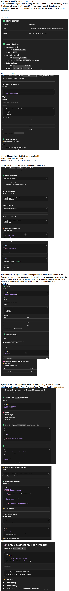

Question In mind for our Reporting Service:
1.Whats the meaning of    private String status; in IncidentReport (Core Table)  is that the Incident Created Event,Incident Updated ecevt ,Incident  Completed etc
2.In IncidentAuditLog  Entity what is the eventType is it the different events of the incidentId's.
Answer:
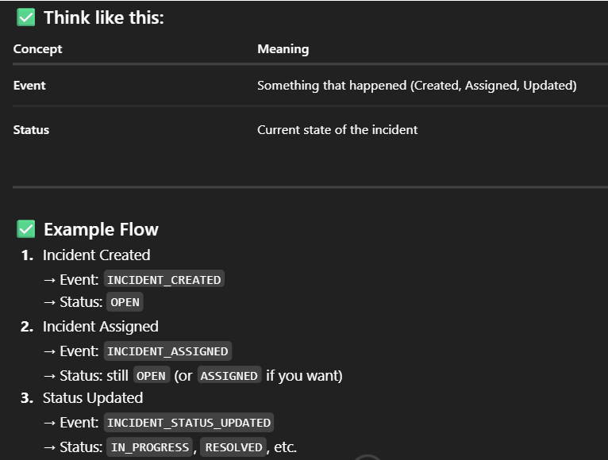

Q of Idempotency:
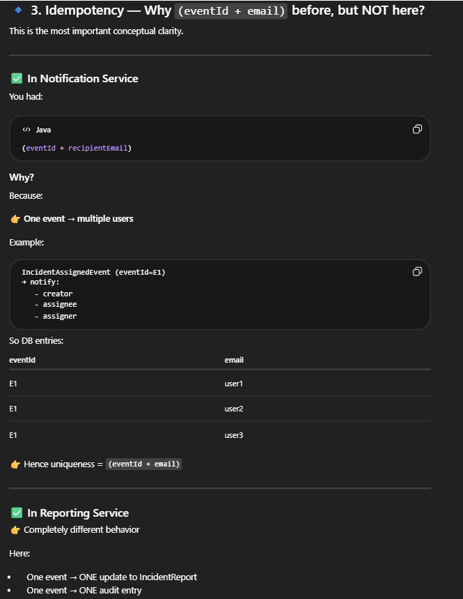

Q in IncidentAuditLog  Entity the we have Doubt:
Are oldValue and newValue
Means StatusOldValue  and StatusNewValue

So Answer is no they are Generic Depends on eventType
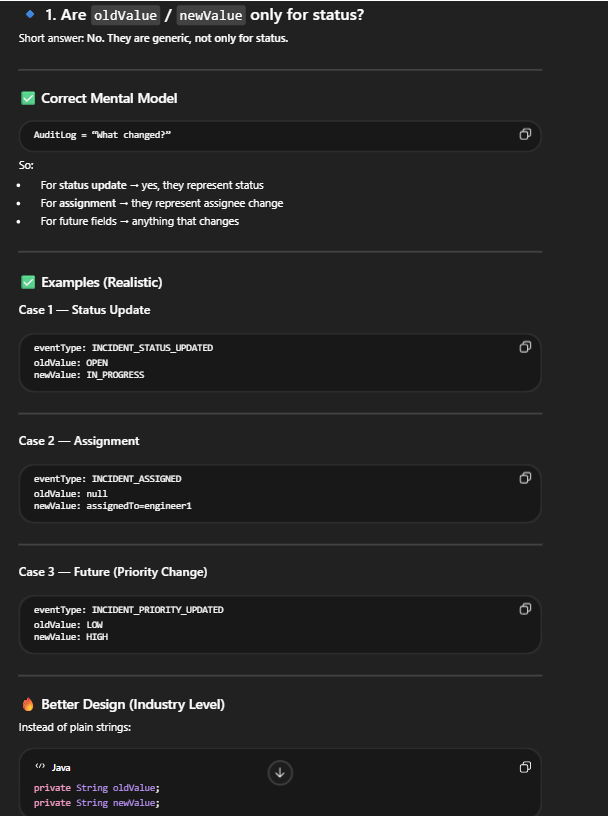
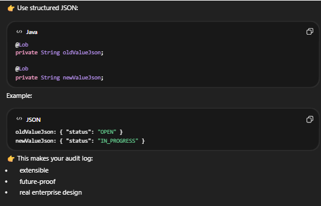
Q.Tell me as u are saying to achieve Idempotency we need to add eventid in the tables… in previous case we are using the combination of both eventId and  email Eg in Notification Service:we are sending the email to multiple users having the same Eventid in email service when we listern the Incident event consumer.
Solution:
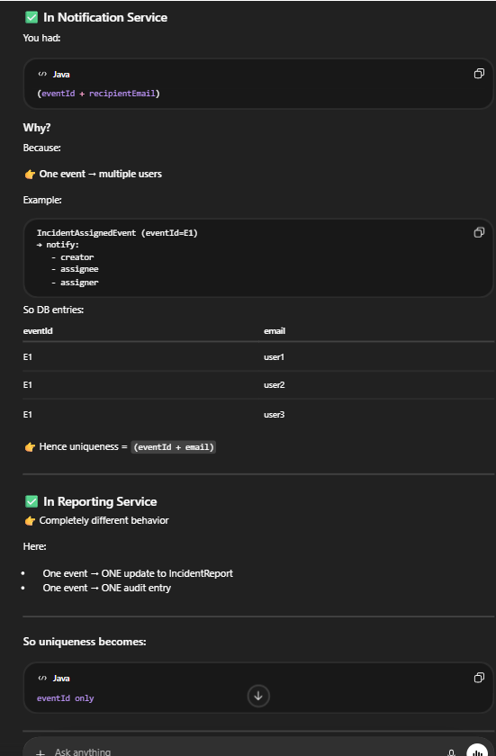
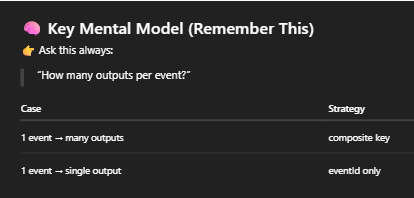
Q so now Should we apply the eventId For Idempodency in each of 3 Tables.
Solution: Make Separate Table :ProcessedEvent Table For Handling Idempodency:
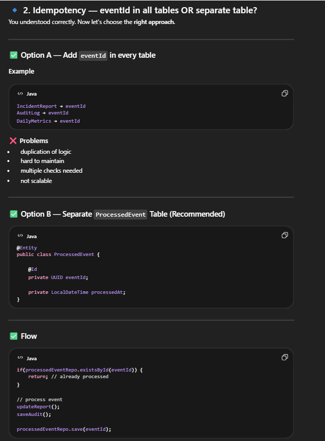
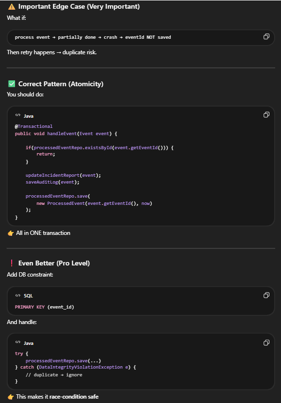
also
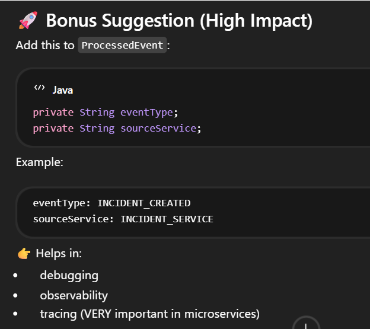

---------------------
In Kakfa consumers:
1.Idempotency = MUST in Kafka
2.Always use DB unique constraint with try-catch combination in code as it handle entry dublcation and stop Kafkalistner retry again because of Buisness logic faliure (not just existsBy fucntion repository as it only handle the Single Thread case)
3.Always return immediately in catch block (except the case if we are using the for loop because )

we also apply for query improvement:
Pagination
Indexing:

rough idea for implementing Indexing on our table based various things:
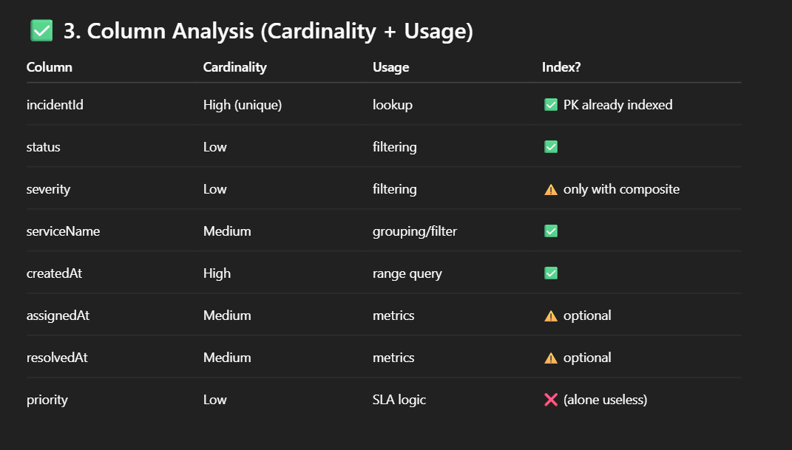

**In our Reporting service :
A. Initially ham atb check karte the set karte assignmentSLABreached and resolutionSLABreached value jab incident assign ya resolve hota hai.
But ab  hamne ye edge cases bhi cover kar deya for assignmentSLABreached and resolutionSLABreached
1.Jab incident Assign hi nahi hya
2.jab incident resolve hi nahi huya
using schedulars… and additionally hamne SchedularLock Bhi lga leya hai for handling the redundency when multiple instance of this service are running..
also hamne kafka  producer for sending emails bhi implement kar de hai when incident breached..

B.we also apply SchedulerLock along with schedular :
because without SchedulerLock: if we deploy multiple instances of reporting  service..then the schedular in each instance will run the schedular so same job runs multiple times in parallel this leads to alot of inconsistency ,duplation etc..
with SchedulerLock: SchedulerLock  Ensures only ONE instance executes the job(schedular) at a time..

we apply the SchedulerLock
---------to be done in future (IMP)**
1.pending work here is we need to Replace scheduler with Redis TTL. such that hamko har baar check na karne parde(using schedular) ki breach huya ki nahi instead after TTL automatically trigger ho jaye
2. Kafka Failure Handling(DLQ)
3. Structured Logging
4. Global Exception Handling
5. Caching

----Thinks learn: 
Pagination needs deterministic ordering
Bulk updates > row-by-row updates
Distributed systems → idempotency is mandatory 

-----------------
We successfully complete the LifeCycle of IncidentBreaching risk and IncidentBreached using the Schedulars

Assignment/Resolution SLA Breaching Risk Flow:

Scheduler runs every minute
↓
Fetch top 50 nearest SLA-risk incidents
(using cursor pagination)
↓
Calculate risk score
↓
Determine risk level
↓
Only if Risk level changed:
- update entity
- publish event
- add to modified list
↓
Bulk save modified incidents
↓
Move cursor forward
↓
Next batch
↓
till the  SLA-risk incidents not get empty
----------------------------------------------

Assignment + Resolution SLA Breached Flow:

Scheduler runs every minute
     ↓    using Bulk update (atomic approach)
updating the (assignment and Resolution ) SLABreached Value from false to true
     ↓   using offset based Pagination
Fetch top 100 nearest Assignemnt breached incidents
        ↓
Publish the AssignmentBreachedEvent Event and then mark AssignmentSlaEventPublished as True
        ↓ move Offset forward
Next  incidents Batch (100 nearest breached)
        ↓
till the assignment breached incidents not get empty

       ↓
Fetch top 100 nearest Resolution breached incidents
        ↓
Publish the publishResolutionBreachedEvent and then mark ResolutionSlaEventPublished as True
        ↓ (move Offset forward)
Next  incidents Batch (100 nearest breached)
        ↓
till the resolvement breached incidents not get empty
